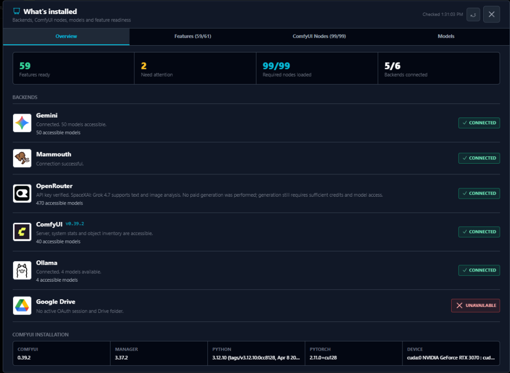
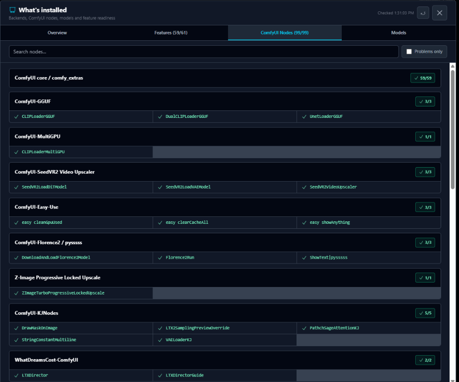
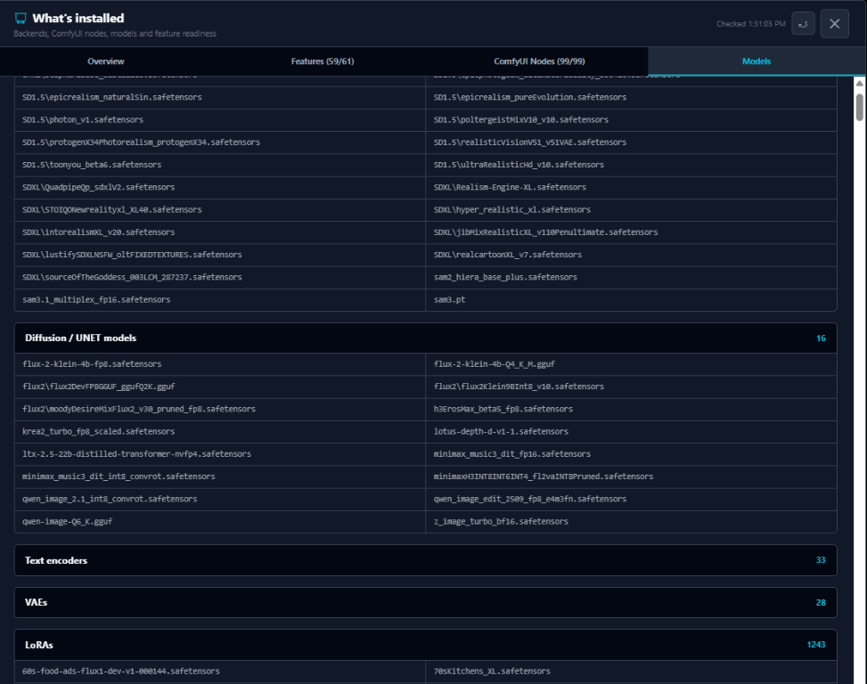

# Connections and local services

[Documentation index](./README.md) | [Project overview](../README.md)

Configure provider access and local servers. Provider tests, catalog refreshes and generation have different costs and data-sharing behavior.

## On this page

- [Connection Settings](#connection-settings)
- [OpenRouter](#openrouter)
- [Ollama](#ollama)
- [ComfyUI](#comfyui)
  - [Header memory controls](#header-memory-controls)
- [Installation overview](#installation-overview)
  - [ComfyUI node checks](#comfyui-node-checks)
  - [ComfyUI model inventory](#comfyui-model-inventory)
- [Live system indicators](#live-system-indicators)
- [Screenshots](#screenshots)
- [Related guides](#related-guides)

## Connection Settings

Connection settings are entered inside the application:

| Setting | Typical value | Required for |
| --- | --- | --- |
| ComfyUI URL | `http://127.0.0.1:8188` | Local workflows |
| Ollama URL | `http://127.0.0.1:11434` | Local prompt tools |
| Ollama model | `huihui_ai/qwen3-vl-abliterated:8b` | Default local vision and text model |
| Mammouth API key | Provider-issued key | Mammouth generation and prompt tools |
| Gemini API key | Google AI key | Direct Gemini generation |
| OpenRouter API key and model | Provider-issued key and model ID | OpenRouter prompt tools |
| Google OAuth client ID | OAuth web client ID | Drive synchronization |
| Civitai API key | Civitai account key | Authenticated model operations |

In Electron, API keys are persisted through `electron-store`. Do not commit API keys or place secrets directly in source files. For browser development, `GEMINI_API_KEY` can be supplied through a local Vite environment file that remains outside version control.

## OpenRouter

- Configure **Connection Settings > OpenRouter API** with your own API key and default model. **Grok 4.7** (`x-ai/grok-4.7`) is preselected. The model selector loads the live OpenRouter catalog and identifies **Text + Vision** versus **Text only** models; Refresh reloads the catalog without changing your selection.
- **Test** verifies the key through `/api/v1/key` and checks the selected model in the catalog. It performs no paid generation and does not guarantee sufficient credits or account access for a subsequent generation. **Save and Close** persists the key/model through Electron's existing local settings store (or browser local storage in web mode). Clearing the key removes it from web storage and disables authenticated requests. Restart Electron after this update to activate the new settings IPC.
- Select **OpenRouter** as the Analysis Provider in **Prompt from Image**, **Extract Background**, **Subject / Object**, or **Magical Prompt Soup**, or use it in **Video > Video Prompt Generator**. Existing prompt-tool formats, history, copy, Library saving and destination actions remain available. OpenRouter rewrites prompts; it is not an image/video rendering provider here.
- Image tools require a vision model. Images are resized to a maximum dimension of 1536 pixels before being sent; selected images and prompt/Soup text are sent to OpenRouter and its downstream model provider on generation. Catalog refresh sends no source images or prompts. Missing keys, unsupported models, API errors, empty output and truncated responses are surfaced explicitly.
- Regression checks: `node --test services/installationDiagnostics.test.mjs services/openRouterService.test.mjs electron/openRouterSettings.test.cjs`.

## Ollama

1. Install and start [Ollama](https://ollama.com/) for Windows.
2. Pull the default local vision model:

	```powershell
	ollama pull huihui_ai/qwen3-vl-abliterated:8b
	```

3. Open **Connection Settings**, keep the default URL `http://127.0.0.1:11434`, and click **Test**. A successful test reports how many installed models are available.
4. Select the default model or another installed model. The Prompt tools refresh their model list from Ollama's `/api/tags` endpoint.

Ollama is available in **Prompt from Image**, **Extract Background**, **Subject / Object**, and **Magical Prompt Soup**. Florence2 remains available only in **Prompt from Image** because its caption tasks cannot reliably isolate a background or subject. Ollama image analysis requests use a larger context window automatically, while Magic Soup asks the selected model to synthesize a new concept instead of concatenating source descriptions.

When using browser-only development, local browser security may block Ollama even when the desktop application works. If that happens, allow the development origin through Ollama's `OLLAMA_ORIGINS` setting and restart Ollama.

## ComfyUI

1. Start ComfyUI with CORS enabled for the application origin. A typical local command includes:

	```powershell
	python main.py --listen 127.0.0.1 --enable-cors-header "*"
	```

2. Enter the ComfyUI URL in **Connection Settings**. The default expected address is `http://127.0.0.1:8188`.
3. Confirm the connection indicator is active. The application then reads installed checkpoints, LoRAs, UNets, VAEs, text encoders, samplers, schedulers, and custom nodes.
4. Open **Models/LoRAs** to select the ComfyUI root folder, scan local models, and retrieve metadata.

LTX 2.3 and LTX 2.5 use the same CacheDiT controls. New projects enable acceleration with 8 warmup steps, a skip interval of 3, a noise scale of `0.001`, and summary output enabled. These defaults do not overwrite explicit values restored from saved projects.

Large local libraries are indexed from these directories:

```text
ComfyUI/models/checkpoints
ComfyUI/models/diffusion_models
ComfyUI/models/loras
```

FLUX2 and KREA2 diffusion models are indexed directly from `ComfyUI/models/diffusion_models`. Their LoRAs use the dedicated `ComfyUI/models/loras/flux2` and `ComfyUI/models/loras/krea` folders.

In Photo Fusion, choose **FLUX2**, **QWEN-Edit**, or **Mammouth** from the engine control. FLUX2 and Qwen Edit run locally through the configured ComfyUI endpoint and expose their own advanced model and sampling settings. Mammouth sends each subject as a distinct multimodal input and exposes the hosted image-model selector instead.

Model-specific metadata is stored beside the model where applicable. Keep these sidecars with the model when moving files outside the application's organizer.

### Header memory controls

The header shows two discreet icon-only memory actions **under the main action buttons on the right**, **only while ComfyUI is connected**, including on small screens. Hover an icon to see its name and explanation; both also have accessible names and keyboard focus indicators. The cube unloads models, while the trash icon clears model and node caches:

- **Clear VRAM** is ComfyUI's native **Unload Models** command: `POST /free` with `{"unload_models":true}`. It unloads currently loaded models and requests cleanup of unused GPU allocations, while keeping node execution results cached. It cannot release memory used by other applications or guarantee that all VRAM drops to zero. A separate Unload Models button would duplicate this action.
- **Free model + node cache** sends `{"unload_models":true,"free_memory":true}` to the same native endpoint. It also resets ComfyUI's execution caches, so later runs may need to reload models and recompute nodes.

These actions target the configured ComfyUI server. They do not delete model files, output files, Library media or queued jobs, and do not send a global interrupt. ComfyUI processes the flags between jobs: **request accepted** is an acknowledgement, not proof that memory has already been released during an active render. Both buttons are disabled while a request is pending; connection, HTTP and unexpected-response failures are shown explicitly. A dismissible notification appears below the icons without expanding the header.

This follows the official [frontend memory commands](https://github.com/Comfy-Org/ComfyUI_frontend/blob/main/src/composables/useCoreCommands.ts), [API payloads](https://github.com/Comfy-Org/ComfyUI_frontend/blob/main/src/scripts/api.ts) and [backend cleanup flags](https://github.com/Comfy-Org/ComfyUI/blob/master/main.py). No custom node is required.

Regression checks: `node --test services/comfyMemoryService.test.mjs components/Header.test.mjs`.

## Installation overview

Open **What's installed** to review backend connectivity, feature readiness, ComfyUI nodes and models. The **Overview** tab summarizes what is ready and what needs attention, with installation details for ComfyUI, Manager, Python, PyTorch and the compute device.



The counts, connection states and versions shown are an example from one installation, not fixed requirements. Use the other tabs to inspect **Features**, **ComfyUI Nodes** and **Models**.

OpenRouter appears alongside the other backends with its connection status, compatible text-model count and selected model's text/vision capability. Refresh verifies the configured key and model catalog without a paid generation. A text-only OpenRouter model can make **Magical Prompt Soup** and text-only **Video Prompt Generator** requests available, but it does not satisfy the image-analysis requirements. Video/audio reference support is checked when generating with the selected model.

### ComfyUI node checks

In **What's installed > ComfyUI Nodes**, inspect the diagnostic's node inventory grouped by core nodes and custom-node packs. Expand a group to see individual node names and availability, use **Search nodes...** to filter by name or pack, or enable **Problems only** to focus on missing nodes.



The counts reflect the nodes checked on this installation, not a guarantee that every workflow has compatible models or can run successfully. Consult the [required-node list](../COMFYUI_REQUIRED_NODES.txt) for workflow dependencies.

### ComfyUI model inventory

In **What's installed > Models**, review the model filenames reported by the connected ComfyUI server, grouped into checkpoints, diffusion/UNET models, text encoders, VAEs, LoRAs and upscaler categories. Expand a category to inspect its entries; the category header shows its count.



This is a diagnostic inventory, not the [Models/LoRAs library](features/models-and-loras.md) used for metadata, previews and organization. Listed files and counts reflect this server's installation; their presence alone does not guarantee compatibility with a selected workflow.

## Live system indicators

- The top header displays CPU, RAM, GPU, VRAM and Temp gauges, refreshed approximately every second while the app is visible. CPU is total system utilization between samples; RAM is physical memory in use, not only the app's memory.
- GPU and VRAM are usage percentages for NVIDIA GPU 0; Temp is that GPU's temperature in degrees Celsius (its bar uses a 0-100 C visual scale). These three sensors use the installed NVIDIA driver's `nvidia-smi`, without requiring ComfyUI. On other GPUs or unavailable sensors, gauges show **N/A** with the reason in a tooltip, not fabricated values.
- Hardware access requires the Electron desktop app. The web-only app shows **N/A**. Restart Electron after installing an update that adds the sensor IPC bridge.

## Screenshots

See the [capture guide](./screenshots/README.md) for filenames and activation steps. These images are planned, not yet included.

<!--  -->

<!--  -->

<!--  -->

## Related guides

- [Detailed ComfyUI workflow dependencies](reference/comfyui-workflows.md)
- [Complete required-node list](../COMFYUI_REQUIRED_NODES.txt)
- [Local Models and LoRAs](features/models-and-loras.md)

---

[Back to documentation index](./README.md)
